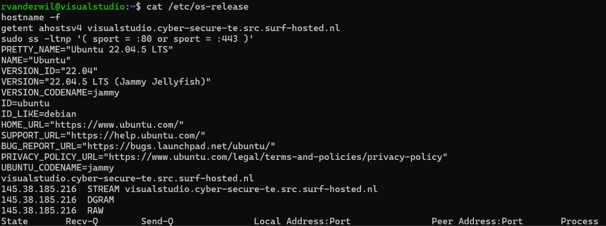

# Visual Studio Code in the Browser on SURF Research Cloud

Deploy a persistent, password-protected code-server workspace on an Ubuntu 22.04 SURF Research Cloud (SRC) VM using Docker Compose and automatic HTTPS.

Example URL:

```text
https://visualstudio.cyber-secure-te.src.surf-hosted.nl
```

code-server provides a browser-accessible editor based on VS Code. It is not the Microsoft desktop VS Code application, and some Microsoft-specific extensions may not be available.

> This is an independent deployment guide. The linked BIG_BLUE_BUTTON_SERVER directory could not be retrieved when the original guide was prepared, so its structure and scripts have not been verified or reproduced.

Last updated: 22 November 2026.

All deployment files belong in `~/VSCode`.

## Contents

1. [Architecture](#architecture)
2. [Requirements](#requirements)
3. [Prepare the SRC workspace](#1-prepare-the-src-workspace)
4. [Connect over SSH](#2-connect-over-ssh)
5. [Install Docker](#3-install-docker-engine-and-compose)
6. [Create the deployment](#4-create-the-deployment)
7. [Start the workspace](#5-start-the-workspace)
8. [Open the editor](#6-open-the-editor)
9. [Work with projects](#7-work-with-projects)
10. [Management and updates](#8-management-and-updates)
11. [Backups](#9-backups)
12. [Troubleshooting](#10-troubleshooting)
13. [Security](#11-security-and-access-boundaries)

## Architecture

```text
Browser
  |
  | HTTPS :443
  v
Caddy reverse proxy
  |
  | HTTP over the Compose network
  v
code-server :8443
  |
  v
/config/workspace
  |
  v
~/VSCode/config/workspace on the VM
```

Only Caddy publishes ports on the VM. The editor's internal port 8443 is not exposed directly.

Caddy obtains and renews the public TLS certificate. Its certificate state is kept in Docker volumes. Editor settings and project files are persisted through a host-directory mount.

## Requirements

- An SRC collaboration with permission to create/manage a workspace.
- An Ubuntu 22.04 VM with SSH access and `sudo` privileges.
- A public DNS name pointing to the VM.
- Inbound TCP ports 80 and 443 available to the reverse proxy.
- Outbound access for package downloads, image pulls, and certificate issuance.
- Suggested starting capacity: 2 vCPUs and 4 GB RAM, with disk space appropriate to your projects. This is a starting suggestion, not a platform minimum.

> Use this standalone configuration on a dedicated VM. If Traefik, Nginx, Caddy, Apache, or BigBlueButton already uses ports 80/443, integrate with that existing reverse proxy instead of starting another proxy on those ports.

## 1. Prepare the SRC workspace

Open the [SRC dashboard](https://portal.live.surfresearchcloud.nl/dashboard/workspaces) and create an Ubuntu 22.04 workspace.

For the example in this guide:

| Setting | Example |
|---|---|
| Workspace hostname | `visualstudio` |
| Sanitized collaboration name | `cyber-secure-te` |
| FQDN | `visualstudio.cyber-secure-te.src.surf-hosted.nl` |

SRC uses the domain pattern:

```text
<hostname>.<sanitized-CO-name>.src.surf-hosted.nl
```

Copy the actual FQDN from your workspace details. Do not blindly convert all hyphens in the Linux hostname into dots: this can corrupt names such as `cyber-secure-te` and `surf-hosted`.

Changing the `DOMAIN` value in Docker Compose does not create a DNS record.

### Security groups

Check the workspace's Security Groups tab:

| Port | Protocol | Purpose |
|---|---|---|
| 22 | TCP | SSH; restrict source addresses where practical |
| 80 | TCP | HTTP redirect and certificate validation |
| 443 | TCP | HTTPS editor access |

SRC documentation lists 22, 80, and 443 as the usual defaults for Linux workspaces. Verify your actual workspace rules. Cloud-level restrictions cannot be opened simply by running `ufw` inside the VM.

Do not add a public security-group rule for port 8443.

## 2. Connect over SSH

Run on your own computer, replacing the username:

```bash
ssh YOUR_SRC_USERNAME@visualstudio.cyber-secure-te.src.surf-hosted.nl
```

All subsequent commands run on the VM unless stated otherwise.

Check the system and existing listeners:

```bash
cat /etc/os-release
hostname -f
getent ahostsv4 visualstudio.cyber-secure-te.src.surf-hosted.nl
sudo ss -ltnp '( sport = :80 or sport = :443 )'
```




Confirm Ubuntu 22.04, verify that DNS matches the public address in SRC, and ensure ports 80/443 are available. Resolve DNS or port conflicts before continuing.

## 3. Install Docker Engine and Compose

### Current VM status

Your supplied terminal output confirms that `hello-world` ran successfully, Compose reported `v5.8.0`, and Docker's service was `active`. Docker installation is complete on this VM. Do not reinstall it.

The earlier APT conflict was resolved by disabling the old repository file:

```text
/etc/apt/sources.list.d/download_docker_com_linux_ubuntu.list.disabled
```

Keep the new `/etc/apt/sources.list.d/docker.sources`. Do not restore the old duplicate entry.

### Create the project directory first

All deployment files in this guide are created in the case-sensitive directory `~/VSCode`:

```bash
mkdir -p ~/VSCode
cd ~/VSCode
```

If you previously created `~/install-docker.sh`, the replacement below is written directly inside `~/VSCode`; it does not depend on the older home-directory script.

### Create `~/VSCode/install-docker.sh`

For portability to a fresh VM, save the following installer. On your current VM it detects working Docker and Compose and exits without changing repositories.

```bash
cat > ~/VSCode/install-docker.sh <<'SCRIPT'
#!/usr/bin/env bash
set -euo pipefail
cd -- "$(dirname -- "${BASH_SOURCE[0]}")"
sudo -v

if sudo docker info >/dev/null 2>&1 && sudo docker compose version >/dev/null 2>&1; then
    echo "Docker and Compose already work; installation skipped."
    sudo docker compose version
    exit 0
fi

# Preserve existing repository definitions instead of adding a duplicate.
if sudo grep -qsF 'download.docker.com/linux/ubuntu' \
    /etc/apt/sources.list /etc/apt/sources.list.d/*.list \
    /etc/apt/sources.list.d/*.sources; then
    echo "Existing Docker repository found; reusing it."
else
    sudo apt-get update
    sudo apt-get install -y ca-certificates curl
    sudo install -m 0755 -d /etc/apt/keyrings
    sudo curl -fsSL https://download.docker.com/linux/ubuntu/gpg \
      -o /etc/apt/keyrings/docker.asc
    sudo chmod a+r /etc/apt/keyrings/docker.asc
    sudo tee /etc/apt/sources.list.d/docker.sources >/dev/null <<EOF
Types: deb
URIs: https://download.docker.com/linux/ubuntu
Suites: $(. /etc/os-release && echo "${UBUNTU_CODENAME:-$VERSION_CODENAME}")
Components: stable
Architectures: $(dpkg --print-architecture)
Signed-By: /etc/apt/keyrings/docker.asc
EOF
fi

sudo apt-get update
sudo apt-get install -y ca-certificates curl openssl dnsutils \
  docker-ce docker-ce-cli containerd.io docker-buildx-plugin docker-compose-plugin
sudo systemctl enable --now docker
sudo docker run --rm hello-world
sudo docker compose version
SCRIPT

bash -n ~/VSCode/install-docker.sh
chmod +x ~/VSCode/install-docker.sh
```

Optional on your current VM; required only if Docker is not already working:

```bash
~/VSCode/install-docker.sh
```

The installer reuses an existing Docker repository instead of creating a competing definition. It does not automatically delete repositories, remove conflicting packages, or repair arbitrary pre-existing APT errors. If `apt-get update` fails, resolve the reported problem before proceeding.

Verify the existing installation if needed:

```bash
sudo docker compose version
sudo systemctl is-active docker
```

## 4. Create the deployment

### 4.1 Directory layout

Every file-creation block below explicitly enters `~/VSCode` before writing files.

```text
~/VSCode/
├── README.md                 # save this guide here if desired
├── install-docker.sh
├── start-vscode.sh
├── Dockerfile
├── docker-compose.yaml
├── Caddyfile
├── .env
├── .gitignore
├── .dockerignore
├── config/
│   └── workspace/
└── backups/                  # created when backing up
```

Prepare persistent storage:

```bash
cd ~/VSCode
mkdir -p config/workspace
chmod 700 .
```

### 4.2 Create `.env` without replacing existing credentials

Run as your normal SSH user, not from a root shell. Change the example domain before first execution if necessary.

```bash
cd ~/VSCode
if [ ! -f .env ]; then
  (
    set -e
    umask 077
    printf 'DOMAIN=%s\n' 'visualstudio.cyber-secure-te.src.surf-hosted.nl'
    printf 'PUID=%s\n' "$(id -u)"
    printf 'PGID=%s\n' "$(id -g)"
    printf 'TZ=%s\n' 'Europe/Amsterdam'
    printf 'CODE_SERVER_PASSWORD=%s\n' "$(openssl rand -hex 24)"
  ) > .env
else
  echo "Keeping existing .env; no password was replaced."
fi
chmod 600 .env
```

Inspect the settings privately and save the password in your password manager:

```bash
cat ~/VSCode/.env
```

### 4.3 Exclude secrets and data from Git and Docker builds

```bash
cd ~/VSCode
cat > .gitignore <<'EOF'
.env
config/
backups/
EOF

cat > .dockerignore <<'EOF'
*
!Dockerfile
EOF
```

The Dockerfile below does not copy project files into the image. This restrictive build context also excludes credentials and workspace data. Adjust it deliberately if you later add `COPY` instructions.

### 4.4 Create `Dockerfile`

```bash
cd ~/VSCode
cat > Dockerfile <<'EOF'
# Deliberately inherit the image's existing entrypoint and runtime behavior.
# Pin this base to a tested digest for reproducible deployments.
FROM lscr.io/linuxserver/code-server:latest
EOF
```

This is a minimal custom-image build definition. It inherits the code-server image unchanged; it does not add Python, Node.js, Docker, or project-specific packages. Extend it deliberately when you need additional tools.

### 4.5 Create `docker-compose.yaml`

The exact filename is `docker-compose.yaml`.

```bash
cd ~/VSCode
cat > docker-compose.yaml <<'EOF'
name: visualstudio

services:
  code-server:
    build:
      context: .
      dockerfile: Dockerfile
    image: src-vscode:local
    restart: unless-stopped
    environment:
      PUID: "${PUID:?Set PUID in .env}"
      PGID: "${PGID:?Set PGID in .env}"
      TZ: "${TZ:-Europe/Amsterdam}"
      PASSWORD: "${CODE_SERVER_PASSWORD:?Set CODE_SERVER_PASSWORD in .env}"
      DEFAULT_WORKSPACE: /config/workspace
    volumes:
      - ./config:/config
    networks:
      - editor
    logging:
      driver: json-file
      options:
        max-size: "10m"
        max-file: "3"

  caddy:
    image: caddy:2
    restart: unless-stopped
    depends_on:
      - code-server
    environment:
      DOMAIN: "${DOMAIN:?Set DOMAIN in .env}"
    ports:
      - "80:80"
      - "443:443"
    volumes:
      - ./Caddyfile:/etc/caddy/Caddyfile:ro
      - caddy_data:/data
      - caddy_config:/config
    networks:
      - editor
    logging:
      driver: json-file
      options:
        max-size: "10m"
        max-file: "3"

networks:
  editor:
    driver: bridge

volumes:
  caddy_data:
  caddy_config:
EOF
```

Compose builds the editor from the Dockerfile in this directory. Caddy is downloaded as a prebuilt image. Only ports 80 and 443 are published; the Docker socket and host root filesystem are not mounted.

### 4.6 Create `Caddyfile`

```bash
cd ~/VSCode
cat > Caddyfile <<'EOF'
{$DOMAIN} {
    encode zstd gzip
    reverse_proxy code-server:8443
}
EOF
```

DNS must point to the VM and public TCP ports 80/443 must reach Caddy. This configuration does not create SRC DNS records.

### 4.7 Create `start-vscode.sh`

```bash
cd ~/VSCode
cat > start-vscode.sh <<'SCRIPT'
#!/usr/bin/env bash
set -euo pipefail
cd -- "$(dirname -- "${BASH_SOURCE[0]}")"
sudo docker compose config --quiet
sudo docker compose build --pull code-server
sudo docker compose pull caddy
sudo docker compose run --rm --no-deps caddy \
  caddy validate --config /etc/caddy/Caddyfile --adapter caddyfile
sudo docker compose up -d
sudo docker compose ps
sudo docker compose logs --tail=80 code-server caddy
SCRIPT

bash -n start-vscode.sh
chmod +x start-vscode.sh
```

The script resolves its own directory before running Compose. It therefore uses the files in `~/VSCode` even when launched from another working directory.

## 5. Start the workspace

Check that no existing web service owns ports 80/443:

```bash
sudo ss -ltnp '( sport = :80 or sport = :443 )'
```

If another service is listening, stop here and plan integration with that service rather than starting a competing proxy.

Start the deployment:

```bash
~/VSCode/start-vscode.sh
```

The script validates Compose, builds the editor image, pulls Caddy, validates its configuration, and starts both services. Configuration validation is not proof of public HTTPS reachability; verify that in your browser afterward.

Follow logs if needed:

```bash
cd ~/VSCode
sudo docker compose logs -f code-server caddy
```

Press `Ctrl+C` to stop following logs without stopping the containers.

## 6. Open the editor

Open:

```text
https://visualstudio.cyber-secure-te.src.surf-hosted.nl
```

Retrieve the login password through SSH:

```bash
cd ~/VSCode
sed -n 's/^CODE_SERVER_PASSWORD=//p' .env
```

Enter that password on the code-server login page.

The default workspace is `/config/workspace`, corresponding to `~/VSCode/config/workspace` on the host.

### Verify the terminal

In the browser editor, choose **Terminal → New Terminal**:

```bash
whoami
pwd
cat /etc/os-release
mkdir -p /config/workspace/hello
cd /config/workspace/hello
printf 'Hello from the SRC Docker workspace\n' > README.txt
cat README.txt
```

The terminal runs inside the container, not directly on the host Ubuntu VM. Host-installed tools do not automatically become available inside the editor container.

## 7. Work with projects

### Clone a repository

In the browser terminal:

```bash
cd /config/workspace
git clone https://github.com/HR-AI-HUB/hr-ai-hub.github.io.git
```

Use **File → Open Folder** to open the cloned repository.

### Preview a development server

If Python 3 is installed in the editor container:

```bash
cd /config/workspace
python3 -m http.server 8000 --bind 127.0.0.1
```

Open:

```text
https://visualstudio.cyber-secure-te.src.surf-hosted.nl/proxy/8000/
```

Code-server's path-based proxy allows this without exposing port 8000 publicly. Some frameworks require their own base-path configuration. Subdomain-based application previews require additional DNS/certificate configuration and are outside this basic setup.

### Adding development tools

Do not assume that Python, Node.js, compilers, or your project dependencies are present. Check inside the editor terminal before using them.

For reproducible environments, build a custom image with a Dockerfile and install system dependencies at build time. Interactive changes outside the `/config` mount may disappear when the container is recreated. Keep project dependency specifications in version control.

## 8. Management and updates

Run from:

```bash
cd ~/VSCode
```

| Task | Command |
|---|---|
| Status | `sudo docker compose ps` |
| Logs | `sudo docker compose logs --tail=100` |
| Follow logs | `sudo docker compose logs -f` |
| Restart editor | `sudo docker compose restart code-server` |
| Stop/remove containers and network | `sudo docker compose down` |
| Start | `sudo docker compose up -d` |

### Change the password

Edit `.env` through SSH:

```bash
nano .env
sudo docker compose up -d code-server
```

Use a strong random hexadecimal password to avoid Compose interpolation issues with characters such as `$`. Never leave `PASSWORD` unset.

### Update images

Back up first, then:

```bash
sudo docker compose build --pull code-server
sudo docker compose pull caddy
sudo docker compose up -d
sudo docker compose logs --tail=100
```

The Dockerfile base and Caddy image use moving tags for convenience. For reproducible deployments, record tested image digests and pin the images to those digests.

List the image IDs used by the current containers:

```bash
sudo docker inspect \
  $(sudo docker compose ps -q) \
  --format '{{.Name}} {{.Config.Image}} {{.Image}}'
```

Record release information and tested dependencies alongside your project documentation.

> `docker compose down` preserves the bind-mounted `config` directory and named volumes. Avoid `docker compose down -v` unless you intentionally want to delete the named volumes, including Caddy's certificate state.

## 9. Backups

This backs up the workspace, editor configuration, deployment files, and `.env`. It briefly stops the editor for consistency, then restarts it even if the archive command fails:

```bash
cd ~/VSCode
mkdir -p backups
chmod 700 backups

(
  set -e
  umask 077

  sudo docker compose stop code-server
  trap 'sudo docker compose start code-server' EXIT

  sudo tar -czf - \
    .env \
    docker-compose.yaml \
    Dockerfile \
    .dockerignore \
    .gitignore \
    install-docker.sh \
    start-vscode.sh \
    Caddyfile \
    config \
    > "backups/visualstudio-$(date +%Y%m%d-%H%M%S).tar.gz"
)
```

The archive contains secrets, possibly including Git credentials and repository data. Encrypt it and keep a copy outside this VM. A backup stored only on the same VM is not sufficient protection against loss of the VM or its disk.

This procedure does not include Caddy's named certificate volumes. Preserve those separately if you require a complete proxy-state backup.

### Restore application data

On a replacement VM with Docker installed, transfer the archive securely. Extract it only into a trusted, empty deployment directory:

```bash
mkdir -p ~/VSCode
cd ~/VSCode

# Replace the example path with your transferred backup archive.
sudo tar -xzf /path/to/visualstudio-backup.tar.gz

chmod 700 .
chmod 600 .env
```

Check `.env`, DNS, and directory ownership before starting. If restoring under a different SSH UID/GID, update `PUID`/`PGID` and adjust `config` ownership accordingly.

```bash
sudo docker compose config --quiet
sudo docker compose build --pull code-server
sudo docker compose pull caddy
sudo docker compose up -d
```

Without restored Caddy certificate state, Caddy must obtain certificates again. Avoid repeated unnecessary reissuance during testing.

## 10. Troubleshooting

### Domain does not resolve or load

```bash
getent ahostsv4 visualstudio.cyber-secure-te.src.surf-hosted.nl
dig +short A visualstudio.cyber-secure-te.src.surf-hosted.nl
dig +short AAAA visualstudio.cyber-secure-te.src.surf-hosted.nl

sudo ss -ltnp '( sport = :80 or sport = :443 )'

cd ~/VSCode
sudo docker compose ps
sudo docker compose logs --tail=150 caddy
```

Check that DNS matches the workspace's public address, the VM is running, and SRC security groups permit TCP 80/443. Any published AAAA record must also route correctly.

### Address already in use

```bash
sudo ss -ltnp '( sport = :80 or sport = :443 )'
sudo docker ps --format 'table {{.Names}}\t{{.Ports}}'
```

Identify the existing service before changing anything. Do not stop a production reverse proxy or BigBlueButton installation just to free these ports.

### Certificate issuance fails

```bash
cd ~/VSCode
sudo docker compose logs --tail=200 caddy
```

Check DNS, inbound connectivity, outbound connectivity, and whether another proxy intercepts requests. Do not repeatedly delete certificate volumes as a troubleshooting shortcut.

### 502 Bad Gateway

```bash
cd ~/VSCode
sudo docker compose logs --tail=150 code-server
sudo docker compose exec code-server \
  curl -I http://127.0.0.1:8443/
```

An HTTP response, including a login redirect, indicates that the editor is answering internally. If it is not, investigate editor startup logs before changing DNS or firewall settings.

### Files cannot be saved

```bash
cd ~/VSCode
id
grep -E '^(PUID|PGID)=' .env
ls -ld config config/workspace
```

For this guide's configuration, ownership should match your SSH user:

```bash
sudo chown -R "$(id -u):$(id -g)" config
sudo docker compose restart code-server
```

Do not use `chmod -R 777` as a permissions workaround.

### Login password is not accepted

Check the stored value privately:

```bash
cd ~/VSCode
sed -n 's/^CODE_SERVER_PASSWORD=//p' .env
sudo docker compose up -d code-server
```

Do not paste `.env` or rendered Compose configuration into public issue trackers: they can contain the password.

## 11. Security and access boundaries

- This is a single-user password-authenticated environment, not automatic SURF SRAM or institutional SSO integration.
- Keep password authentication enabled and use HTTPS.
- Treat browser-terminal access as access to the files, credentials, and network available to the editor container.
- Do not expose port 8443 publicly.
- Do not mount `/var/run/docker.sock` merely to make Docker accessible in the editor; host Docker access is a major privilege boundary.
- Administer host Docker through your SSH session in this deployment.
- Keep `.env`, backups, tokens, and private SSH keys out of Git.
- Use separate environments and an explicitly designed access-control model for multiple users.
- Follow your institution's policies before storing personal, confidential, or research-sensitive data.

### Existing Traefik or another reverse proxy

If this VM already has Traefik or another proxy:

1. Do not start the Caddy service in this example.
2. Connect code-server to the existing proxy's Docker network.
3. Configure that proxy to route the exact domain to code-server's HTTP port 8443.
4. Keep TLS and certificate management in the existing proxy.
5. Use that deployment's actual network names, entry points, and certificate resolver; do not invent replacements.

The Compose file above is the standalone variant and must be adapted before use with an existing proxy.

## Documentation

- [Docker Engine on Ubuntu](https://docs.docker.com/engine/install/ubuntu/)
- [LinuxServer code-server image](https://docs.linuxserver.io/images/docker-code-server/)
- [Securely expose code-server](https://coder.com/docs/code-server/guide/)
- [Caddy reverse-proxy quick start](https://caddyserver.com/docs/quick-starts/reverse-proxy)
- [SRC workspace FQDN / URL](https://servicedesk.surf.nl/wiki/spaces/WIKI/pages/102827593/The+workspace+s+FQDN+URL)
- [SRC: Open ports on a workspace](https://servicedesk.surf.nl/wiki/spaces/WIKI/pages/37388804/How+to+open+ports+on+your+workspace)
- [Requested reference directory](https://github.com/HR-AI-HUB/hr-ai-hub.github.io/tree/main/BIG_BLUE_BUTTON_SERVER)

## Deployment checklist

- [ ] Ubuntu 22.04 workspace created.
- [ ] Actual SRC FQDN verified.
- [ ] DNS resolves to the intended workspace.
- [ ] Ports 80/443 are available and reachable.
- [ ] Docker Engine and Compose plugin work.
- [ ] Installer, startup script, Dockerfile, and docker-compose.yaml are in `~/VSCode`.
- [ ] `.env` created with correct UID/GID and strong password.
- [ ] Password saved securely.
- [ ] Compose and Caddy configurations validate.
- [ ] Containers are running.
- [ ] HTTPS certificate is valid.
- [ ] Browser login and terminal work.
- [ ] Workspace files persist after container recreation.
- [ ] Backups are stored securely outside the VM.
- [ ] Image versions/digests and project dependencies are recorded where reproducibility is required.
