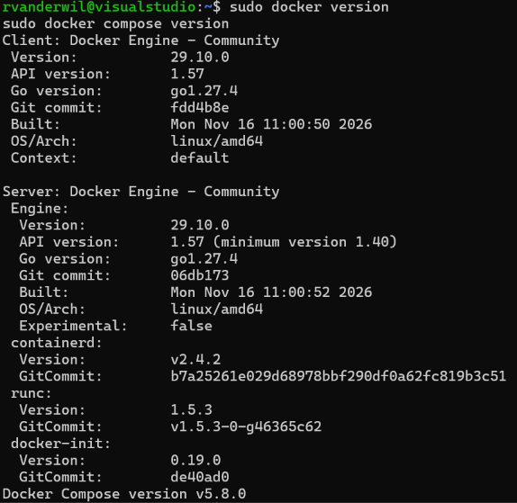

# Visual Studio Code in the Browser on SURF Research Cloud

Deploy a persistent, password-protected code-server workspace on an Ubuntu 22.04 SURF Research Cloud (SRC) VM using Docker Compose and automatic HTTPS.

Example URL:

```text
https://visualstudio.cyber-secure-te.src.surf-hosted.nl
```

code-server provides a browser-accessible editor based on VS Code. It is not the Microsoft desktop VS Code application, and some Microsoft-specific extensions may not be available.

> This is an independent deployment guide. The linked BIG_BLUE_BUTTON_SERVER directory could not be retrieved when this document was prepared, so its structure and scripts have not been verified or reproduced.

Last updated: 22 November 2026.

## Contents

1. [Architecture](#architecture)
2. [Requirements](#requirements)
3. [Prepare the SRC workspace](#1-prepare-the-src-workspace)
4. [Connect over SSH](#2-connect-over-ssh)
5. [Install Docker](#3-install-docker-engine-and-compose)
6. [Create the deployment](#4-create-the-deployment)
7. [Start the workspace](#5-start-the-workspace)
8. [Open the editor](#6-open-the-editor)
9. [Work with projects](#7-work-with-projects)
10. [Management and updates](#8-management-and-updates)
11. [Backups](#9-backups)
12. [Troubleshooting](#10-troubleshooting)
13. [Security](#11-security-and-access-boundaries)

## Architecture

```text
Browser
  |
  | HTTPS :443
  v
Caddy reverse proxy
  |
  | HTTP over the Compose network
  v
code-server :8443
  |
  v
/config/workspace
  |
  v
~/VISUALSTUDIO/config/workspace on the VM
```

Only Caddy publishes ports on the VM. The editor's internal port 8443 is not exposed directly.

Caddy obtains and renews the public TLS certificate. Its certificate state is kept in Docker volumes. Editor settings and project files are persisted through a host-directory mount.

## Requirements

- An SRC collaboration with permission to create/manage a workspace.
- An Ubuntu 22.04 VM with SSH access and `sudo` privileges.
- A public DNS name pointing to the VM.
- Inbound TCP ports 80 and 443 available to the reverse proxy.
- Outbound access for package downloads, image pulls, and certificate issuance.
- Suggested starting capacity: 2 vCPUs and 4 GB RAM, with disk space appropriate to your projects. This is a starting suggestion, not a platform minimum.

> Use this standalone configuration on a dedicated VM. If Traefik, Nginx, Caddy, Apache, or BigBlueButton already uses ports 80/443, integrate with that existing reverse proxy instead of starting another proxy on those ports.

## 1. Prepare the SRC workspace

Open the [SRC dashboard](https://portal.live.surfresearchcloud.nl/dashboard/workspaces) and create an Ubuntu 22.04 workspace.

For the example in this guide:

| Setting | Example |
|---|---|
| Workspace hostname | `visualstudio` |
| Sanitized collaboration name | `cyber-secure-te` |
| FQDN | `visualstudio.cyber-secure-te.src.surf-hosted.nl` |

SRC uses the domain pattern:

```text
<hostname>.<sanitized-CO-name>.src.surf-hosted.nl
```

Copy the actual FQDN from your workspace details. Do not blindly convert all hyphens in the Linux hostname into dots: this can corrupt names such as `cyber-secure-te` and `surf-hosted`.

Changing the `DOMAIN` value in Docker Compose does not create a DNS record.

### Security groups

Check the workspace's Security Groups tab:

| Port | Protocol | Purpose |
|---|---|---|
| 22 | TCP | SSH; restrict source addresses where practical |
| 80 | TCP | HTTP redirect and certificate validation |
| 443 | TCP | HTTPS editor access |

SRC documentation lists 22, 80, and 443 as the usual defaults for Linux workspaces. Verify your actual workspace rules. Cloud-level restrictions cannot be opened simply by running `ufw` inside the VM.

Do not add a public security-group rule for port 8443.

## 2. Connect over SSH

Run on your own computer, replacing the username:

```bash
ssh YOUR_SRC_USERNAME@visualstudio.cyber-secure-te.src.surf-hosted.nl
```

All subsequent commands run on the VM unless stated otherwise.

Check the system and existing listeners:

```bash
cat /etc/os-release
hostname -f
getent ahostsv4 visualstudio.cyber-secure-te.src.surf-hosted.nl
sudo ss -ltnp '( sport = :80 or sport = :443 )'
```


Confirm Ubuntu 22.04, verify that DNS matches the public address in SRC, and ensure ports 80/443 are available. Resolve DNS or port conflicts before continuing.

## 3. Install Docker Engine and Compose

### 3.1 Check for an existing installation

```bash
sudo docker version
sudo docker compose version
```



If both commands work, keep the existing installation and continue to section 4. The screenshot above is a relative repository asset; keep `output002.png` alongside this README if you want it displayed.

The script below is intended for a fresh Ubuntu 22.04 VM. If Docker reports conflicts with packages such as `docker.io`, `containerd`, or `runc`, consult the official Docker installation guide before removing anything. Do not replace an existing installation blindly on a VM hosting other services.

### 3.2 Create `install-docker.sh`

In your SSH terminal on the Ubuntu VM, paste the entire block below, including the opening `cat` command and final `SCRIPT` line. This creates the script without running it.

Use plain URLs in shell commands, not Markdown links such as `[https://example.com](https://example.com)`.

```bash
cat > ~/install-docker.sh <<'SCRIPT'
#!/usr/bin/env bash
set -euo pipefail

echo "Installing Docker Engine and Docker Compose..."
sudo -v

echo "[1/6] Installing prerequisites..."
sudo apt-get update
sudo apt-get install -y ca-certificates curl openssl dnsutils

echo "[2/6] Adding Docker's signing key..."
sudo install -m 0755 -d /etc/apt/keyrings
sudo curl -fsSL https://download.docker.com/linux/ubuntu/gpg \
  -o /etc/apt/keyrings/docker.asc
sudo chmod a+r /etc/apt/keyrings/docker.asc

echo "[3/6] Configuring Docker's APT repository..."
sudo tee /etc/apt/sources.list.d/docker.sources >/dev/null <<EOF
Types: deb
URIs: https://download.docker.com/linux/ubuntu
Suites: $(. /etc/os-release && echo "${UBUNTU_CODENAME:-$VERSION_CODENAME}")
Components: stable
Architectures: $(dpkg --print-architecture)
Signed-By: /etc/apt/keyrings/docker.asc
EOF

echo "[4/6] Installing Docker packages..."
sudo apt-get update
sudo apt-get install -y \
  docker-ce \
  docker-ce-cli \
  containerd.io \
  docker-buildx-plugin \
  docker-compose-plugin

echo "[5/6] Enabling and starting Docker..."
sudo systemctl enable --now docker

echo "[6/6] Testing Docker and Docker Compose..."
sudo docker run --rm hello-world
sudo docker compose version

echo
echo "Docker Engine and Docker Compose installation completed."
SCRIPT
```

The quoted outer `SCRIPT` delimiter preserves variable expressions until the installer runs. The inner `EOF` block writes Docker's APT repository configuration during execution. Keep both closing delimiters at the beginning of their lines.

### 3.3 Check the script syntax

```bash
bash -n ~/install-docker.sh
```

No output means Bash found no syntax errors. This does not execute the installer or verify package availability, network connectivity, or compatibility with existing software.

### 3.4 Make the script executable and run it

```bash
chmod +x ~/install-docker.sh
~/install-docker.sh
```

Enter your SSH user's sudo password if prompted. Run this from your normal SSH account; the script invokes `sudo` where needed.

Alternatively, execute it explicitly with Bash:

```bash
bash ~/install-docker.sh
```

Choose one execution method, not both. Do not invoke this Bash script using `sh`.

`set -euo pipefail` enables stricter error handling. If installation fails, inspect the reported error and resolve it before continuing. A syntax check alone does not demonstrate a successful installation.

### 3.5 Verify the installation

```bash
sudo docker --version
sudo docker compose version
sudo systemctl is-active docker
```

The service-status command should print:

```text
active
```

This guide uses `sudo docker`; adding your user to the Docker group is not required.

The installer only installs Docker and Compose. It does not create the editor workspace, configure DNS, or start Caddy/code-server. Continue with section 4 below.

## 4. Create the deployment

### 4.1 Create the directory

```bash
mkdir -p ~/VISUALSTUDIO
cd ~/VISUALSTUDIO
mkdir -p config/workspace
chmod 700 .
```

The deployment will contain:

```text
VISUALSTUDIO/
├── .env
├── .gitignore
├── Caddyfile
├── docker-compose.yaml
├── config/
│   └── workspace/
└── backups/                 # created when backing up
```

### 4.2 Create `.env`

Run as your normal SSH user, not from a root shell. Change the domain below if your actual SRC FQDN differs.

> Run this generation block only for initial setup. Re-running it replaces `.env` and generates a new password.

```bash
cd ~/VISUALSTUDIO

(
  umask 077
  printf 'DOMAIN=%s\n' 'visualstudio.cyber-secure-te.src.surf-hosted.nl'
  printf 'PUID=%s\n' "$(id -u)"
  printf 'PGID=%s\n' "$(id -g)"
  printf 'TZ=%s\n' 'Europe/Amsterdam'
  printf 'CODE_SERVER_PASSWORD=%s\n' "$(openssl rand -hex 24)"
) > .env

chmod 600 .env
cat .env
```

Save the generated password in a password manager. `PUID` and `PGID` align the editor's persistent files with your SSH user's host UID/GID.

### 4.3 Create `.gitignore`

```bash
cat > .gitignore <<'EOF'
.env
config/
backups/
EOF
```

### 4.4 Create `docker-compose.yaml`

```bash
cat > docker-compose.yaml <<'EOF'
name: visualstudio

services:
  code-server:
    image: lscr.io/linuxserver/code-server:latest
    restart: unless-stopped
    environment:
      PUID: "${PUID:?Set PUID in .env}"
      PGID: "${PGID:?Set PGID in .env}"
      TZ: "${TZ:-Europe/Amsterdam}"
      PASSWORD: "${CODE_SERVER_PASSWORD:?Set CODE_SERVER_PASSWORD in .env}"
      DEFAULT_WORKSPACE: /config/workspace
    volumes:
      - ./config:/config
    networks:
      - editor
    logging:
      driver: json-file
      options:
        max-size: "10m"
        max-file: "3"

  caddy:
    image: caddy:2
    restart: unless-stopped
    depends_on:
      - code-server
    environment:
      DOMAIN: "${DOMAIN:?Set DOMAIN in .env}"
    ports:
      - "80:80"
      - "443:443"
    volumes:
      - ./Caddyfile:/etc/caddy/Caddyfile:ro
      - caddy_data:/data
      - caddy_config:/config
    networks:
      - editor
    logging:
      driver: json-file
      options:
        max-size: "10m"
        max-file: "3"

networks:
  editor:
    driver: bridge

volumes:
  caddy_data:
  caddy_config:
EOF
```

There is intentionally no `ports:` section for code-server. For this image, Caddy connects using HTTP to internal port 8443; the browser-facing connection uses HTTPS.

The Docker socket and host root filesystem are intentionally not mounted into the editor.

### 4.5 Create `Caddyfile`

```bash
cat > Caddyfile <<'EOF'
{$DOMAIN} {
    encode zstd gzip
    reverse_proxy code-server:8443
}
EOF
```

Public DNS must resolve to this VM and inbound ports 80/443 must reach Caddy for automatic public HTTPS to work.

## 5. Start the workspace

Validate, download images, and start:

```bash
cd ~/VISUALSTUDIO

sudo docker compose config --quiet
sudo docker compose pull

sudo docker compose run --rm --no-deps caddy \
  caddy validate \
  --config /etc/caddy/Caddyfile \
  --adapter caddyfile

sudo docker compose up -d
sudo docker compose ps
sudo docker compose logs --tail=100 code-server caddy
```

To follow logs:

```bash
sudo docker compose logs -f code-server caddy
```

Press `Ctrl+C` to stop following logs. This does not stop the containers.

## 6. Open the editor

Open:

```text
https://visualstudio.cyber-secure-te.src.surf-hosted.nl
```

Retrieve the login password through SSH:

```bash
cd ~/VISUALSTUDIO
sed -n 's/^CODE_SERVER_PASSWORD=//p' .env
```

Enter that password on the code-server login page.

The default workspace is `/config/workspace`, corresponding to `~/VISUALSTUDIO/config/workspace` on the host.

### Verify the terminal

In the browser editor, choose **Terminal → New Terminal**:

```bash
whoami
pwd
cat /etc/os-release
mkdir -p /config/workspace/hello
cd /config/workspace/hello
printf 'Hello from the SRC Docker workspace\n' > README.txt
cat README.txt
```

The terminal runs inside the container, not directly on the host Ubuntu VM. Host-installed tools do not automatically become available inside the editor container.

## 7. Work with projects

### Clone a repository

In the browser terminal:

```bash
cd /config/workspace
git clone https://github.com/HR-AI-HUB/hr-ai-hub.github.io.git
```

Use **File → Open Folder** to open the cloned repository.

### Preview a development server

If Python 3 is installed in the editor container:

```bash
cd /config/workspace
python3 -m http.server 8000 --bind 127.0.0.1
```

Open:

```text
https://visualstudio.cyber-secure-te.src.surf-hosted.nl/proxy/8000/
```

Code-server's path-based proxy allows this without exposing port 8000 publicly. Some frameworks require their own base-path configuration. Subdomain-based application previews require additional DNS/certificate configuration and are outside this basic setup.

### Adding development tools

Do not assume that Python, Node.js, compilers, or your project dependencies are present. Check inside the editor terminal before using them.

For reproducible environments, build a custom image with a Dockerfile and install system dependencies at build time. Interactive changes outside the `/config` mount may disappear when the container is recreated. Keep project dependency specifications in version control.

## 8. Management and updates

Run from:

```bash
cd ~/VISUALSTUDIO
```

| Task | Command |
|---|---|
| Status | `sudo docker compose ps` |
| Logs | `sudo docker compose logs --tail=100` |
| Follow logs | `sudo docker compose logs -f` |
| Restart editor | `sudo docker compose restart code-server` |
| Stop/remove containers and network | `sudo docker compose down` |
| Start | `sudo docker compose up -d` |

### Change the password

Edit `.env` through SSH:

```bash
nano .env
sudo docker compose up -d code-server
```

Use a strong random hexadecimal password to avoid Compose interpolation issues with characters such as `$`. Never leave `PASSWORD` unset.

### Update images

Back up first, then:

```bash
sudo docker compose pull
sudo docker compose up -d
sudo docker compose logs --tail=100
```

The example uses moving tags for convenience. For reproducible deployments, record tested image digests and pin the images to those digests.

List the image IDs used by the current containers:

```bash
sudo docker inspect \
  $(sudo docker compose ps -q) \
  --format '{{.Name}} {{.Config.Image}} {{.Image}}'
```

Record release information and tested dependencies alongside your project documentation.

> `docker compose down` preserves the bind-mounted `config` directory and named volumes. Avoid `docker compose down -v` unless you intentionally want to delete the named volumes, including Caddy's certificate state.

## 9. Backups

This backs up the workspace, editor configuration, deployment files, and `.env`. It briefly stops the editor for consistency, then restarts it even if the archive command fails:

```bash
cd ~/VISUALSTUDIO
mkdir -p backups
chmod 700 backups

(
  set -e
  umask 077

  sudo docker compose stop code-server
  trap 'sudo docker compose start code-server' EXIT

  sudo tar -czf - \
    .env \
    docker-compose.yaml \
    Caddyfile \
    config \
    > "backups/visualstudio-$(date +%Y%m%d-%H%M%S).tar.gz"
)
```

The archive contains secrets, possibly including Git credentials and repository data. Encrypt it and keep a copy outside this VM. A backup stored only on the same VM is not sufficient protection against loss of the VM or its disk.

This procedure does not include Caddy's named certificate volumes. Preserve those separately if you require a complete proxy-state backup.

### Restore application data

On a replacement VM with Docker installed, transfer the archive securely. Extract it only into a trusted, empty deployment directory:

```bash
mkdir -p ~/VISUALSTUDIO
cd ~/VISUALSTUDIO

# Replace the example path with your transferred backup archive.
sudo tar -xzf /path/to/visualstudio-backup.tar.gz

chmod 700 .
chmod 600 .env
```

Check `.env`, DNS, and directory ownership before starting. If restoring under a different SSH UID/GID, update `PUID`/`PGID` and adjust `config` ownership accordingly.

```bash
sudo docker compose config --quiet
sudo docker compose pull
sudo docker compose up -d
```

Without restored Caddy certificate state, Caddy must obtain certificates again. Avoid repeated unnecessary reissuance during testing.

## 10. Troubleshooting

### Domain does not resolve or load

```bash
getent ahostsv4 visualstudio.cyber-secure-te.src.surf-hosted.nl
dig +short A visualstudio.cyber-secure-te.src.surf-hosted.nl
dig +short AAAA visualstudio.cyber-secure-te.src.surf-hosted.nl

sudo ss -ltnp '( sport = :80 or sport = :443 )'

cd ~/VISUALSTUDIO
sudo docker compose ps
sudo docker compose logs --tail=150 caddy
```

Check that DNS matches the workspace's public address, the VM is running, and SRC security groups permit TCP 80/443. Any published AAAA record must also route correctly.

### Address already in use

```bash
sudo ss -ltnp '( sport = :80 or sport = :443 )'
sudo docker ps --format 'table {{.Names}}\t{{.Ports}}'
```

Identify the existing service before changing anything. Do not stop a production reverse proxy or BigBlueButton installation just to free these ports.

### Certificate issuance fails

```bash
cd ~/VISUALSTUDIO
sudo docker compose logs --tail=200 caddy
```

Check DNS, inbound connectivity, outbound connectivity, and whether another proxy intercepts requests. Do not repeatedly delete certificate volumes as a troubleshooting shortcut.

### 502 Bad Gateway

```bash
cd ~/VISUALSTUDIO
sudo docker compose logs --tail=150 code-server
sudo docker compose exec code-server \
  curl -I http://127.0.0.1:8443/
```

An HTTP response, including a login redirect, indicates that the editor is answering internally. If it is not, investigate editor startup logs before changing DNS or firewall settings.

### Files cannot be saved

```bash
cd ~/VISUALSTUDIO
id
grep -E '^(PUID|PGID)=' .env
ls -ld config config/workspace
```

For this guide's configuration, ownership should match your SSH user:

```bash
sudo chown -R "$(id -u):$(id -g)" config
sudo docker compose restart code-server
```

Do not use `chmod -R 777` as a permissions workaround.

### Login password is not accepted

Check the stored value privately:

```bash
cd ~/VISUALSTUDIO
sed -n 's/^CODE_SERVER_PASSWORD=//p' .env
sudo docker compose up -d code-server
```

Do not paste `.env` or rendered Compose configuration into public issue trackers: they can contain the password.

## 11. Security and access boundaries

- This is a single-user password-authenticated environment, not automatic SURF SRAM or institutional SSO integration.
- Keep password authentication enabled and use HTTPS.
- Treat browser-terminal access as access to the files, credentials, and network available to the editor container.
- Do not expose port 8443 publicly.
- Do not mount `/var/run/docker.sock` merely to make Docker accessible in the editor; host Docker access is a major privilege boundary.
- Administer host Docker through your SSH session in this deployment.
- Keep `.env`, backups, tokens, and private SSH keys out of Git.
- Use separate environments and an explicitly designed access-control model for multiple users.
- Follow your institution's policies before storing personal, confidential, or research-sensitive data.

### Existing Traefik or another reverse proxy

If this VM already has Traefik or another proxy:

1. Do not start the Caddy service in this example.
2. Connect code-server to the existing proxy's Docker network.
3. Configure that proxy to route the exact domain to code-server's HTTP port 8443.
4. Keep TLS and certificate management in the existing proxy.
5. Use that deployment's actual network names, entry points, and certificate resolver; do not invent replacements.

The Compose file above is the standalone variant and must be adapted before use with an existing proxy.

## Documentation

- [Docker Engine on Ubuntu](https://docs.docker.com/engine/install/ubuntu/)
- [LinuxServer code-server image](https://docs.linuxserver.io/images/docker-code-server/)
- [Securely expose code-server](https://coder.com/docs/code-server/guide/)
- [Caddy reverse-proxy quick start](https://caddyserver.com/docs/quick-starts/reverse-proxy)
- [SRC workspace FQDN / URL](https://servicedesk.surf.nl/wiki/spaces/WIKI/pages/102827593/The+workspace+s+FQDN+URL)
- [SRC: Open ports on a workspace](https://servicedesk.surf.nl/wiki/spaces/WIKI/pages/37388804/How+to+open+ports+on+your+workspace)
- [Requested reference directory](https://github.com/HR-AI-HUB/hr-ai-hub.github.io/tree/main/BIG_BLUE_BUTTON_SERVER)

## Deployment checklist

- [ ] Ubuntu 22.04 workspace created.
- [ ] Actual SRC FQDN verified.
- [ ] DNS resolves to the intended workspace.
- [ ] Ports 80/443 are available and reachable.
- [ ] Docker Engine and Compose plugin work (installed using `install-docker.sh` if needed).
- [ ] `.env` created with correct UID/GID and strong password.
- [ ] Password saved securely.
- [ ] Compose and Caddy configurations validate.
- [ ] Containers are running.
- [ ] HTTPS certificate is valid.
- [ ] Browser login and terminal work.
- [ ] Workspace files persist after container recreation.
- [ ] Backups are stored securely outside the VM.
- [ ] Image versions/digests and project dependencies are recorded where reproducibility is required.
